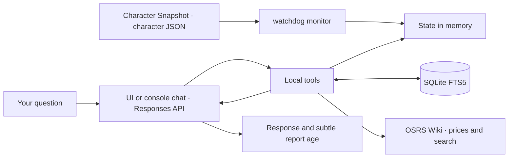

<div align="center">

# ⚔️ OSRS GPT Companion

[Español](README.md) · **English** · [Português (Brasil)](README.pt-BR.md)

**Your character, your goals, and an agent that remembers how you like to play.**

A Python assistant for **Old School RuneScape**, with an OSRS-style local interface and console, using character data
exported by RuneLite's **Character Snapshot** plugin, local memory, and tools
the model can call during a conversation.


[Quick start](#-quick-start) · [How it works](#-how-it-works) · [Tools](#-agent-tools) · [Roadmap](#-roadmap)

</div>

---

## 🎮 What can you do?

Discuss your progress and keep your preferences across sessions:

> “Remember that I want to earn the Quest Cape and prefer to avoid the Wilderness.”
>
> “Check my skills and quests. Which goal should I tackle next?”
>
> “What did I save about Dragon Slayer?”
>
> “Check the price of Abyssal whip and verify Dragon Slayer II requirements on the wiki.”

- **Updated, filtered state:** watches the **Character Snapshot** JSON with `watchdog` and queries only the needed data.
- **Persistent memory:** stores goals and preferences in SQLite FTS5 with flexible token search.
- **Seven tools:** granular character queries, Grand Exchange prices, OSRS Wiki, and persistent memory.
- **Sign in with ChatGPT:** local OAuth authentication with PKCE, token refresh, and encrypted storage using Windows DPAPI.
- **Responses API:** HTTP/SSE transport with `store: false` and `stream: true`.

**The application runs on your PC; inference runs at OpenAI.** State and memories
retrieved by the model are sent as context for those requests. Character tools
send filtered results, never the full JSON. Wiki queries and item names are sent
to the public OSRS Wiki APIs.

This translates the documentation. The console commands, interface messages,
and the agent's current default language remain Spanish.

## 🚀 Quick start

### Requirements

- Windows and Python **3.11 or later**.
- Git to clone the project.
- An eligible ChatGPT account with permission to use its plan through SIWC.
- RuneLite with **Character Snapshot** installed and enabled. This repository does not install the plugin.
- Your character's JSON file, generated by Character Snapshot in a folder you choose.

### Installation

In PowerShell:

```powershell
git clone https://github.com/mauricio-castano-dev/osrs-gpt-companion.git
Set-Location osrs-gpt-companion

python -m venv .venv
.\.venv\Scripts\python.exe -m pip install -e .
.\.venv\Scripts\python.exe main.py --install-path
```

You do not need to activate the environment or configure `OPENAI_API_KEY`.

### Launch from any folder

After installing the launchers, **open a new terminal** so Windows loads the
updated PATH. From any folder, use:

```powershell
osrs-companion
osrs-companion-ui
osrs-companion --cli
```

`osrs-companion` opens the browser interface by default. `--cli` keeps console
chat available. You can also double-click `osrs-companion-ui.cmd` in the project
folder. Launchers use absolute paths to `.venv` Python and `main.py`, and are
also installed in `%LOCALAPPDATA%\OSRSGPTCompanion\bin`. The installer adds
that folder to your user PATH idempotently, preserving other entries. Run the
installer again if you move the project.

### Configure Character Snapshot and connect your character

1. Install and enable **Character Snapshot** in RuneLite.
2. When the plugin asks for an export folder, choose the folder you want to use. **You choose the folder**; do not assume an automatic location inside `.runelite`.
3. Locate the exported JSON. Its filename is **your character's name followed by `.json`**, rather than a fixed project filename.
4. Launch the assistant with `--state-file` and the full path to that file.

For example, if you choose `C:\OSRS\Snapshots` and your character is called
`ExamplePlayer`, the file will be `C:\OSRS\Snapshots\ExamplePlayer.json`:

```powershell
osrs-companion --state-file 'C:\OSRS\Snapshots\ExamplePlayer.json'
```

Replace both the folder and `ExamplePlayer` with your actual export values.
The filename is not derived from your Windows username, GitHub username, or
repository name. For multiple characters, select the appropriate JSON each
session. Keep the quotation marks when a path or character name contains spaces.

On first use, your browser opens so you can sign in and authorize plan usage.
Eligibility, models, and limits depend on your account and granted permissions.

To check the installation with **fictional data**, without signing in:

```powershell
osrs-companion --check-state --state-file .\examples\player.example.json
```

`examples/player.example.json` contains fictional data for checking installation.
To use your real state for the first time, pass `--state-file` pointing to
`<character_name>.json` in the folder you selected in Character Snapshot. The last
valid path you explicitly select is saved for future launches.

## 🧭 How it works



1. Character Snapshot exports data to your chosen folder. The monitor loads the selected JSON and updates the cache when it detects changes, including full file replacements.
2. Your message is sent to the model with instructions and tool schemas.
3. The model can request one or more functions. Python validates arguments and executes only the allowed functions.
4. Filtered results, memories, or external data return through `function_call_output`, linked to the original `call_id`. The full character JSON is never sent to the model.
5. The loop continues until a final answer, with limits of **8 rounds** and **24 calls** per turn.

File changes update the cache; model requests happen during your chat turns.
The monitor watches the latest available Character Snapshot export. It does
not independently verify that RuneLite is still connected.

## 🛠 Agent tools

Functions are grouped in the `osrs` namespace with strict JSON schemas.

| Tool | Purpose |
| --- | --- |
| `query_player_stats` | Skills, world, quick prayers, and vitals; optional active farming, birdhouses, unlocked prayers, KC, POH, transport, and minigame data. |
| `query_player_bank` | Search items and inspect equipment and liquidity; `source=all` or `bank` includes up to eight personal GE offers. |
| `query_quests_and_diaries` | Quests, diaries, and `combat_achievements`: tier summaries and up to 25 combat tasks only for a specific search. |
| `check_ge_price` | Fetch observed Grand Exchange prices and the time of each observation. |
| `search_osrs_wiki` | Find OSRS Wiki pages and retrieve a verifiable introduction with its link. |
| `save_agent_memory` | Save goals, preferences, and plans expressed by the user. |
| `recall_agent_memory` | Retrieve memories by keywords, using AND first and OR as a fallback. |

Memory search uses **safe Unicode tokens**. It first requires every term
(`AND`); if there are no results, it searches for any term (`OR`). Words do not
need to be adjacent. Up to eight memories are ranked by relevance and date;
the agent must check partial matches before using them.

Character queries use the RAM cache. Results include `ok`, update timestamps,
and limits: up to **30 bank items**, **40 quests**, and **30 tasks per region**.
An empty search does not list the bank. Diaries without a search show tier status
only. Missing values are distinguished from a known zero.

Prices come from the OSRS Wiki API, with up to five matches and their timestamps.
The item catalog is cached in RAM for **six hours**. Wiki search returns up to
three links and a plain-text introduction from the first page, within an overall
budget of **2,500 bytes**. Redirects are resolved; introductions shorter than
250 characters trigger an additional extract of the first sections. The extract
may still omit requirements or drop tables. Calls use a descriptive `User-Agent` and a session without OpenAI credentials.


### Farming and additional progress

With `include_slayer_and_timers=true`, farming filters active patches before
applying limits: it omits `EMPTY`, `Weeds`, and `Compost Bin`, returning up to
**25 patches** with `active_count`, `empty_omitted_count`, `total_patches`, and
`truncated`. `HARVESTABLE`, `DEAD`, and `GROWING` crops are no longer hidden behind
empty patches. Up to eight structured birdhouses are preserved in full. Older
timer formats retain the generic summary of up to 12 entries.

Extras include `killCounts`, `activityCounts`, `minigamePoints`, `house`,
`transport`, and `location`. Unlocked prayers appear in `prayers`, outside
`player`. GE offers are the character's offers exported by Character Snapshot;
they do not replace a query for current market prices.

For Combat Achievements use `category="combat_achievements"`. Without a
`search_term`, only the six-tier summary and points are returned. A search by
task, monster, or tier returns up to **25 tasks**, respecting `status_filter`.
`category="all"` also includes the summary. The full task catalog is never sent.

## ⌨️ Commands

| Command | Action |
| --- | --- |
| `/salir` | Close the console while keeping the authentication session. |
| `/estado` | Show a local character, update, GP, and active patch summary without calling the model. |
| `/memorias` | List the latest 20 memories with IDs and dates without calling the model. |
| `/olvidar ID` | Delete a local memory by ID and report whether it existed; no model call. |
| `/limpiar` | Clear the in-memory chat history; keep SQLite memories. |
| `/uso` | Open ChatGPT usage controls. |
| `/logout` | Attempt to revoke the session and remove local tokens. |

```powershell
# Sign in or authorize again
osrs-companion --login

# List models available to your account
osrs-companion --models

# Choose a model and character file
osrs-companion --model SLUG --state-file 'C:\OSRS\Snapshots\ExamplePlayer.json'

# Validate the JSON without calling the model
osrs-companion --check-state --state-file 'C:\OSRS\Snapshots\ExamplePlayer.json'
```


### Local commands and startup preferences

`/estado` displays five lines with `ok`, `lastUpdated`, character name, combat
level, world, bank/inventory GP equivalents, and active farming patch count.
Unavailable state is reported without presenting old values as current.
`/memorias` shows `[#id] (created_at) tema: contenido`; `/olvidar 3` deletes
memory ID 3 or reports that it does not exist. These commands do not generate
inference requests or enter the history sent to the model. Model discovery and
authentication may still access the network when the application starts.

Explicit `--state-file` and `--model` options override values saved in
`.auth/settings.json`. A path is saved only after its JSON loads successfully;
`--check-state --state-file ...` also saves it without contacting OpenAI. Models
are saved after validation against the catalog. If a saved path no longer
exists, the legacy default path is used. If the saved model is unavailable,
the first catalog model is selected. Fallbacks do not overwrite your saved
choices. Corrupted settings are ignored and can be replaced with valid options.

After choosing the path and model, you can launch with:

```powershell
osrs-companion
```

### Tool visibility and the interface hook

The console shows `[Consultando herramienta: query_player_stats]` with a validated
name for each new call. `answer(question, model, history, router,
on_tool_call=None)` accepts an optional observer receiving `(tool_name, ok_status)`
after execution. Structured errors report `False`; an already satisfied duplicate
save remains successful. Unknown names use the local tool label and report
`local`. Arguments are not logged. Repeated calls with the same ID are neither
executed nor reported twice. Observer errors are reported without interrupting
the turn. The OSRS interface uses this hook for each response's tool chips.

### OSRS interface and report age

The HUD shows character name, combat level, world, Quest Points, GP, skills,
farming, and birdhouses. It refreshes every **3 seconds** through the local API
without calling the model. Harvestable crops are green, growing crops amber,
and dead crops red. The memory tab lets you forget a record with `✕`.

Chat supports simple formatting, links, code blocks, tool chips, Enter to send,
and Shift + Enter for a new line. Clearing chat preserves SQLite memories.
Responses should be concise; timestamps stay out of the model's text unless
you explicitly ask about them or the state is unavailable. Console replies have
a dim `↳ Instantánea: hace 8 s` footer; the UI uses small text at 50–55 % opacity.

The default address is `http://127.0.0.1:8765`; an occupied port falls back to a
free one. Choose a port with `--port 9000` or request automatic allocation with
`--port 0`. The server accepts loopback connections only, validates Host and
Origin, requires a session CSRF token for POST/DELETE, and does not enable
external CORS. Do not expose this desktop interface through port forwarding.

| Local endpoint | Action |
| --- | --- |
| `GET /api/status` | Filtered RAM state, model, path, and relative age; no inference. |
| `GET /api/memories` | Latest 30 local memories. |
| `POST /api/memories/delete` | Delete `{ "id": 3 }`, with a CSRF token. |
| `POST /api/chat` | Send `{ "message": "..." }`; receive the reply, used tools, and report age. |

Chat history is serialized with a lock; a second simultaneous query returns 409.
History remains temporary and is lost when the server closes. APIs and pages
use `Cache-Control: no-store`. OpenAI tokens never reach the browser; the CSRF
token is separate and exists only for the local server session.


### Equipment, progress, and live tools

The HUD has three tabs: **Habilidades & Runs**, **Equipo & Progreso**, and
**Memorias**. The progress tab shows occupied equipment slots, personal GE offers
with quantities/prices, Slayer master/task/streak/points, quest counts, Combat
Achievement tiers, and highlighted KC. Missing data is reported without invented
values; unavailable snapshots do not expose old values as current. Tabs support
arrow keys, Home, and End.

During a query, `GET /api/status` exposes `busy` and `active_tools`. Fast 600 ms polling during a turn updates the chat indicator with tools whose execution has completed.
This is not token streaming or a notification that a tool has just started:
it uses the post-execution callback. Progress clears on completion, failure, or
history reset; the final response keeps its tool chips.

Chat groups `-`, `*`, or numbered items into HTML lists, recognizes `#`/`##`/`###`
headings, preserves code blocks, and skips redundant blank lines. Rendering uses
DOM nodes and text, never `innerHTML` for character or model data. CSP and
CSRF/origin protections remain in place.

### Instant bank search and model switching

In **Equipo & Progreso**, search by name or itemId under **Banco & Inventario**.
After a 180 ms debounce, `GET /api/bank?q=...` queries the in-memory snapshot:
it neither reads the JSON from disk nor calls OpenAI, so it uses no model tokens.
Results include quantities, bank match and total counts, up to 30 bank items,
and the filtered inventory. Queries allow up to 100 characters; unavailable
snapshots do not show stale data. Speed depends on the computer; debounce and
HTTP transport add latency.

The chat header selector fetches your account catalog with `GET /api/models`
once and caches it for the server session. `POST /api/model` validates the
selection and saves it in `.auth/settings.json` for subsequent turns and restarts,
preserving the conversation. Changes are blocked during a response and protected
by CSRF. A persistence failure preserves the previous model. If catalog loading
fails, the selector stays hidden and chat remains available with the current
model. Reload the page to retry.

While a message is being submitted, status polling runs every **600 ms**;
the fast timer is cleared on both success and failure. The usual three-second
refresh remains active outside a turn.

### In-memory quest, diary, and combat achievement explorer

Under **Equipo & Progreso → Misiones & Logros**, search by quest name, diary
region/task, boss, or combat tier. Select `all`, `quests`, `diaries`, or
`combat_achievements` and filter by `all`, `in_progress`, `incomplete`, or
`completed`. Typing uses a 180 ms debounce; selector changes query immediately.
An empty search with default filters makes no request. Out-of-order responses
are discarded so the latest filter wins.

`GET /api/progress?q=...&category=...&status=...` uses only the RAM monitor:
no disk reads, model calls, or conversation history changes. Queries allow up to
100 trimmed characters; invalid filters return 400. Results show up to 40 quests,
30 tasks per diary, and 25 combat tasks with counts and truncation notices.
Diary summaries count completed tiers against exported boolean tiers and show
each region. Unavailable snapshots clear the summary; new queries do not expose
old data as current.

Existing monitor rules remain: diary details require a region/task text match;
combat task details require a name, boss, ID, or tier search. Selecting only the
combat category does not download its full catalog. `in_progress` applies to
quests; diaries and combat tasks use completed/incomplete. Diary tiers retain
their full context even when tasks are filtered. Previous search results do not
refresh automatically; change a filter to query the in-memory snapshot again.

### Modern retro interface and quick filters (0.5.0)

The Obsidian Runic Slate & Amber Gold theme combines dark slate with gold, cyan,
green, and violet. Pixelify Sans and Chakra Petch style the headings and HUD;
Plus Jakarta Sans keeps chat and memories readable. Google Fonts loads these
fonts; offline, Segoe UI, Consolas, and system fonts provide fallbacks. Font
requests to Google are separate from agent tools. Character JSON and memories
are not sent to load fonts.

There are 39 original RPG-inspired SVG sprites embedded as CSS `data:` images,
covering all 24 skills, equipment, and HUD resources. These are not official
assets downloaded from Jagex. Skills expose `data-skill`, and levels of 99 or
above use `.skill-max`. Diaries and combat tiers use two-column cards; the
layout adapts to narrow screens and respects reduced-motion preferences.

**Misiones & Logros** sits immediately after bank search and before equipment.
**En curso**, **Misiones pendientes**, **Misiones completadas**, and
**Diarios pendientes** apply category/status immediately, preserving search text.
Quest rows retain exported state labels with state colors; empty category headings
are omitted when another category contains results.

Filters always attempt `/api/progress`. On failure, a previously received valid
`/api/status` snapshot can be filtered in browser memory, with a visible **partial
fallback** notice and report age. This copy lasts until page reload and uses no
persistent storage. It contains at most the report's first 40 quests and diary/
combat summaries, which may omit tasks. An empty fallback result does not prove
that the character has no matches; query again with the server available for a
complete filter. Without a valid copy, the usual local error remains. A newly
received invalid snapshot disables the previous fallback.

CSP allows only Google Fonts for external styles/fonts and `data:` sprites,
retaining `script-src 'self'`, `connect-src 'self'`, and no `unsafe-inline`.
Icons use spans/pseudo-elements; names remain safe text rather than HTML.

## 🗂 Project structure

```text
osrs-gpt-companion/
├── auth.py              # OAuth, PKCE, identity, DPAPI, and refresh
├── web_app.py           # Loopback API + CSRF
├── launcher.py          # Windows PATH
├── pyproject.toml       # Console entry points
├── ui/                  # HTML / CSS / JS
├── test_frontend.py     # Optional JS rendering tests
├── tests/ui.test.cjs     # Synthetic DOM, no browser
├── test_web_app.py      # Local API tests
├── test_app_shell.py    # Freshness + launchers
├── main.py              # Console and monitor lifecycle
├── inference.py         # Responses API, SSE, and tool loop
├── state_monitor.py     # JSON cache and file events
├── memory_db.py         # Persistent SQLite FTS5 memory
├── tools.py             # Schemas and dispatch for seven tools
├── wiki_client.py       # Prices, search, and item catalog cache
├── osrs_reader.py       # Previous reader retained for compatibility
├── test_agent.py        # Agent and monitor tests
├── test_queries.py      # Filters, limits, routing, and FTS5 search
├── test_wiki_client.py  # Mocked APIs, cache, and User-Agent
├── test_companion.py    # Authentication and compatibility tests
├── examples/
│   └── player.example.json
├── requirements.txt
├── README.md            # Spanish
├── README.en.md         # English
├── README.pt-BR.md      # Brazilian Portuguese
└── CHANGELOG.md
```

## 🔐 Local data

| Location | Contents |
| --- | --- |
| `.auth/host.json` | Persistent installation identifier. |
| `.auth/profile.dpapi` | Credentials encrypted for the current Windows user. |
| `.auth/settings.json` | Last valid state path and model explicitly selected through CLI; written atomically. |
| `memories.sqlite3` | Persistent goals and preferences; **not encrypted**. |
| Item catalog cache | OSRS Wiki mapping in RAM, expiring after six hours. |
| `<character_name>.json` | Character Snapshot data in the folder you selected. |

Git excludes credentials, local databases, character files, Python environments,
and backups. Published examples are fictional. Chat history keeps the latest six
exchanges in memory only. Persistent memory stores what is submitted to the tool;
it does not automatically record a transcript of every conversation.

`store: false` is an API parameter. It does not mean inference happens offline
or that tool results remain exclusively on your PC.

## 🧪 Tests

```powershell
.\.venv\Scripts\python.exe -m unittest -v
```

Tests use temporary files, fictional tokens, and simulated responses. They do
not require a ChatGPT session or consume your plan. They check the monitor,
SQLite FTS5 token search, filters and output limits, authentication, tool arguments,
execution limits, and SSE. External APIs are mocked to verify `User-Agent`, caching,
timestamps, extracts, and error handling without network access.
DPAPI tests require access to the Windows user's encryption profile.

The client accepts connections that omit `Content-Type` if the body contains
valid SSE events. It rejects malformed events and responses without completion
confirmation; incomplete tool calls are not executed.

Optionally, Node.js runs twenty-five additional rendering tests with a synthetic DOM.
It is not required to install, build, or use the application. When available,
`python -m unittest -v` also runs this check.

## 📌 Current scope

- OSRS-style local interface and console for Windows; one ChatGPT profile per installation.
- The file must contain a JSON object of up to **1 MiB**.
- Tools expose filtered results. `snapshot()` remains available for local checks and is not exposed to the model. Required results are still sent again within a turn with `store: false`.
- Preference changes are stored as new dated records.
- Failed requests are not automatically retried; memories already saved remain stored.
- Descriptions tell the model when to check state; they do not guarantee it will do so in every answer.
- External query tools are limited to OSRS Wiki and its price API; general web browsing and game control are not included.
- API failures return explicit tool errors; the agent must acknowledge that the information could not be verified.

## 🗺 Roadmap

- [x] Granular skill, item, and quest queries to reduce context.
- [x] OSRS Wiki and Grand Exchange price queries.
- [x] Character file selection through CLI and persistent path/model preferences.
- [x] Local memory listing and deletion by ID.
- [ ] Direct editing of existing memories.
- [x] Executed tool names, a UI callback, and a local state command.
- [ ] Detailed usage metrics per request.

Checked items are implemented; unchecked items are planned improvements.

## 🤝 Development and documentation

Behavior changes should include relevant tests and updates to all three README
versions and the [changelog](CHANGELOG.md), currently maintained in Spanish.
The Spanish README is the reference version. Each translation should describe
current behavior; proposals belong in the roadmap.

When reporting an issue, include the command, error message, and Python version.
Share only fictional examples or data you intend to make public.

## 📚 References

- [Sign in with ChatGPT: registration and sign-in](https://developers.openai.com/siwc/token-sharing-open-source/sign-in)
- [SIWC: models and inference](https://developers.openai.com/siwc/token-sharing-open-source/models-and-inference)
- [SIWC: current limitations](https://developers.openai.com/siwc/token-sharing-open-source/preview-limitations)
- [Responses API: function calling](https://developers.openai.com/api/docs/guides/function-calling)
- [watchdog](https://python-watchdog.readthedocs.io/en/stable/quickstart.html)
- [SQLite FTS5](https://www.sqlite.org/fts5.html)
- [OSRS Wiki: Real-time Prices](https://oldschool.runescape.wiki/w/RuneScape:Real-time_Prices)

---

Independent project, not officially affiliated with Jagex or OpenAI.
