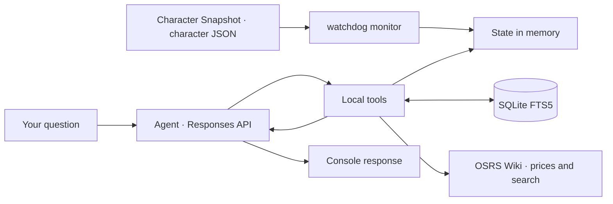

<div align="center">

# ⚔️ OSRS GPT Companion

[Español](README.md) · **English** · [Português (Brasil)](README.pt-BR.md)

**Your character, your goals, and an agent that remembers how you like to play.**

A Python console assistant for **Old School RuneScape**, using character data
exported by RuneLite's **Character Snapshot** plugin, local memory, and tools
the model can call during a conversation.


[Quick start](#-quick-start) · [How it works](#-how-it-works) · [Tools](#-agent-tools) · [Roadmap](#-roadmap)

</div>

---

## 🎮 What can you do?

Discuss your progress and keep your preferences across sessions:

> “Remember that I want to earn the Quest Cape and prefer to avoid the Wilderness.”
>
> “Check my skills and quests. Which goal should I tackle next?”
>
> “What did I save about Dragon Slayer?”
>
> “Check the price of Abyssal whip and verify Dragon Slayer II requirements on the wiki.”

- **Updated, filtered state:** watches the **Character Snapshot** JSON with `watchdog` and queries only the needed data.
- **Persistent memory:** stores goals and preferences in SQLite FTS5 with flexible token search.
- **Seven tools:** granular character queries, Grand Exchange prices, OSRS Wiki, and persistent memory.
- **Sign in with ChatGPT:** local OAuth authentication with PKCE, token refresh, and encrypted storage using Windows DPAPI.
- **Responses API:** HTTP/SSE transport with `store: false` and `stream: true`.

**The application runs on your PC; inference runs at OpenAI.** State and memories
retrieved by the model are sent as context for those requests. Character tools
send filtered results, never the full JSON. Wiki queries and item names are sent
to the public OSRS Wiki APIs.

This translates the documentation. The console commands, interface messages,
and the agent's current default language remain Spanish.

## 🚀 Quick start

### Requirements

- Windows and Python **3.11 or later**.
- Git to clone the project.
- An eligible ChatGPT account with permission to use its plan through SIWC.
- RuneLite with **Character Snapshot** installed and enabled. This repository does not install the plugin.
- Your character's JSON file, generated by Character Snapshot in a folder you choose.

### Installation

In PowerShell:

```powershell
git clone https://github.com/mauricio-castano-dev/osrs-gpt-companion.git
Set-Location osrs-gpt-companion

python -m venv .venv
.\.venv\Scripts\python.exe -m pip install -r requirements.txt
.\.venv\Scripts\python.exe main.py --init
```

You do not need to activate the environment or configure `OPENAI_API_KEY`.

### Configure Character Snapshot and connect your character

1. Install and enable **Character Snapshot** in RuneLite.
2. When the plugin asks for an export folder, choose the folder you want to use. **You choose the folder**; do not assume an automatic location inside `.runelite`.
3. Locate the exported JSON. Its filename is **your character's name followed by `.json`**, rather than a fixed project filename.
4. Launch the assistant with `--state-file` and the full path to that file.

For example, if you choose `C:\OSRS\Snapshots` and your character is called
`ExamplePlayer`, the file will be `C:\OSRS\Snapshots\ExamplePlayer.json`:

```powershell
.\.venv\Scripts\python.exe main.py --state-file 'C:\OSRS\Snapshots\ExamplePlayer.json'
```

Replace both the folder and `ExamplePlayer` with your actual export values.
The filename is not derived from your Windows username, GitHub username, or
repository name. For multiple characters, select the appropriate JSON each
session. Keep the quotation marks when a path or character name contains spaces.

On first use, your browser opens so you can sign in and authorize plan usage.
Eligibility, models, and limits depend on your account and granted permissions.

To check the installation with **fictional data**, without signing in:

```powershell
.\.venv\Scripts\python.exe main.py --check-state --state-file .\examples\player.example.json
```

`examples/player.example.json` contains fictional data for checking installation.
To use your real state, always pass `--state-file` pointing to
`<character_name>.json` in the folder you selected in Character Snapshot.

## 🧭 How it works



1. Character Snapshot exports data to your chosen folder. The monitor loads the selected JSON and updates the cache when it detects changes, including full file replacements.
2. Your message is sent to the model with instructions and tool schemas.
3. The model can request one or more functions. Python validates arguments and executes only the allowed functions.
4. Filtered results, memories, or external data return through `function_call_output`, linked to the original `call_id`. The full character JSON is never sent to the model.
5. The loop continues until a final answer, with limits of **8 rounds** and **24 calls** per turn.

File changes update the cache; model requests happen during your chat turns.
The monitor watches the latest available Character Snapshot export. It does
not independently verify that RuneLite is still connected.

## 🛠 Agent tools

Functions are grouped in the `osrs` namespace with strict JSON schemas.

| Tool | Purpose |
| --- | --- |
| `query_player_stats` | Selected skills, basic identity, and vitals; optional Slayer, daily activity, and timer summaries. |
| `query_player_bank` | Search bank/inventory by name or ID; inspect equipment and Coins/Platinum token liquidity. |
| `query_quests_and_diaries` | Quests and diaries filtered by name, category, and status, with overall counts. |
| `check_ge_price` | Fetch observed Grand Exchange prices and the time of each observation. |
| `search_osrs_wiki` | Find OSRS Wiki pages and retrieve a verifiable introduction with its link. |
| `save_agent_memory` | Save goals, preferences, and plans expressed by the user. |
| `recall_agent_memory` | Retrieve memories by keywords, using AND first and OR as a fallback. |

Memory search uses **safe Unicode tokens**. It first requires every term
(`AND`); if there are no results, it searches for any term (`OR`). Words do not
need to be adjacent. Up to eight memories are ranked by relevance and date;
the agent must check partial matches before using them.

Character queries use the RAM cache. Results include `ok`, update timestamps,
and limits: up to **30 bank items**, **40 quests**, and **30 tasks per region**.
An empty search does not list the bank. Diaries without a search show tier status
only. Missing values are distinguished from a known zero.

Prices come from the OSRS Wiki API, with up to five matches and their timestamps.
The item catalog is cached in RAM for **six hours**. Wiki search returns up to
three links and a plain-text introduction from the first page, within an overall
budget of approximately **2.5 KB**. Introductions may omit requirements or drop
tables. Calls use a descriptive `User-Agent` and a session without OpenAI credentials.

## ⌨️ Commands

| Command | Action |
| --- | --- |
| `/salir` | Close the console while keeping the authentication session. |
| `/limpiar` | Clear the in-memory chat history; keep SQLite memories. |
| `/uso` | Open ChatGPT usage controls. |
| `/logout` | Attempt to revoke the session and remove local tokens. |

```powershell
# Sign in or authorize again
.\.venv\Scripts\python.exe main.py --login

# List models available to your account
.\.venv\Scripts\python.exe main.py --models

# Choose a model and character file
.\.venv\Scripts\python.exe main.py --model SLUG --state-file 'C:\OSRS\Snapshots\ExamplePlayer.json'

# Validate the JSON without calling the model
.\.venv\Scripts\python.exe main.py --check-state --state-file 'C:\OSRS\Snapshots\ExamplePlayer.json'
```

## 🗂 Project structure

```text
osrs-gpt-companion/
├── auth.py              # OAuth, PKCE, identity, DPAPI, and refresh
├── main.py              # Console and monitor lifecycle
├── inference.py         # Responses API, SSE, and tool loop
├── state_monitor.py     # JSON cache and file events
├── memory_db.py         # Persistent SQLite FTS5 memory
├── tools.py             # Schemas and dispatch for seven tools
├── wiki_client.py       # Prices, search, and item catalog cache
├── osrs_reader.py       # Previous reader retained for compatibility
├── test_agent.py        # Agent and monitor tests
├── test_queries.py      # Filters, limits, routing, and FTS5 search
├── test_wiki_client.py  # Mocked APIs, cache, and User-Agent
├── test_companion.py    # Authentication and compatibility tests
├── examples/
│   └── player.example.json
├── requirements.txt
├── README.md            # Spanish
├── README.en.md         # English
├── README.pt-BR.md      # Brazilian Portuguese
└── CHANGELOG.md
```

## 🔐 Local data

| Location | Contents |
| --- | --- |
| `.auth/host.json` | Persistent installation identifier. |
| `.auth/profile.dpapi` | Credentials encrypted for the current Windows user. |
| `memories.sqlite3` | Persistent goals and preferences; **not encrypted**. |
| Item catalog cache | OSRS Wiki mapping in RAM, expiring after six hours. |
| `<character_name>.json` | Character Snapshot data in the folder you selected. |

Git excludes credentials, local databases, character files, Python environments,
and backups. Published examples are fictional. Chat history keeps the latest six
exchanges in memory only. Persistent memory stores what is submitted to the tool;
it does not automatically record a transcript of every conversation.

`store: false` is an API parameter. It does not mean inference happens offline
or that tool results remain exclusively on your PC.

## 🧪 Tests

```powershell
.\.venv\Scripts\python.exe -m unittest -v
```

Tests use temporary files, fictional tokens, and simulated responses. They do
not require a ChatGPT session or consume your plan. They check the monitor,
SQLite FTS5 token search, filters and output limits, authentication, tool arguments,
execution limits, and SSE. External APIs are mocked to verify `User-Agent`, caching,
timestamps, extracts, and error handling without network access.
DPAPI tests require access to the Windows user's encryption profile.

The client accepts connections that omit `Content-Type` if the body contains
valid SSE events. It rejects malformed events and responses without completion
confirmation; incomplete tool calls are not executed.

## 📌 Current scope

- Windows console interface and one ChatGPT profile per installation.
- The file must contain a JSON object of up to **1 MiB**.
- Tools expose filtered results. `snapshot()` remains available for local checks and is not exposed to the model. Required results are still sent again within a turn with `store: false`.
- Preference changes are stored as new dated records.
- Failed requests are not automatically retried; memories already saved remain stored.
- Descriptions tell the model when to check state; they do not guarantee it will do so in every answer.
- External queries are limited to OSRS Wiki and its price API; general web browsing and game control are not included.
- API failures return explicit tool errors; the agent must acknowledge that the information could not be verified.

## 🗺 Roadmap

- [x] Granular skill, item, and quest queries to reduce context.
- [x] OSRS Wiki and Grand Exchange price queries.
- [ ] Character selection and persistent path configuration.
- [ ] Memory management: list, update, and delete preferences.
- [ ] Better visibility into usage and RuneLite update status.

Checked items are implemented; unchecked items are planned improvements.

## 🤝 Development and documentation

Behavior changes should include relevant tests and updates to all three README
versions and the [changelog](CHANGELOG.md), currently maintained in Spanish.
The Spanish README is the reference version. Each translation should describe
current behavior; proposals belong in the roadmap.

When reporting an issue, include the command, error message, and Python version.
Share only fictional examples or data you intend to make public.

## 📚 References

- [Sign in with ChatGPT: registration and sign-in](https://developers.openai.com/siwc/token-sharing-open-source/sign-in)
- [SIWC: models and inference](https://developers.openai.com/siwc/token-sharing-open-source/models-and-inference)
- [SIWC: current limitations](https://developers.openai.com/siwc/token-sharing-open-source/preview-limitations)
- [Responses API: function calling](https://developers.openai.com/api/docs/guides/function-calling)
- [watchdog](https://python-watchdog.readthedocs.io/en/stable/quickstart.html)
- [SQLite FTS5](https://www.sqlite.org/fts5.html)
- [OSRS Wiki: Real-time Prices](https://oldschool.runescape.wiki/w/RuneScape:Real-time_Prices)

---

Independent project, not officially affiliated with Jagex or OpenAI.
