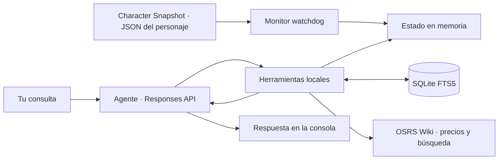

<div align="center">

# ⚔️ OSRS GPT Companion

**Español** · [English](README.en.md) · [Português (Brasil)](README.pt-BR.md)

**Tu personaje, tus objetivos y un agente que recuerda cómo te gusta jugar.**

Un asistente de consola para **Old School RuneScape**, construido en Python,
con estado exportado por el plugin **Character Snapshot** de RuneLite, memoria local y herramientas que el modelo
puede consultar durante la conversación.


[Inicio rápido](#-inicio-rápido) · [Funcionamiento](#-cómo-funciona) · [Herramientas](#-herramientas-del-agente) · [Próximos pasos](#-próximos-pasos)

</div>

---

## 🎮 ¿Qué puedes hacer?

Conversa sobre tu progreso y conserva tus preferencias entre sesiones:

> «Recuerda que quiero conseguir Quest Cape y prefiero evitar Wilderness.»
>
> «Revisa mis habilidades y misiones. ¿Qué objetivo debería completar después?»
>
> «¿Qué había guardado sobre Dragon Slayer?»
>
> «Consulta el precio de Abyssal whip y verifica los requisitos de Dragon Slayer II en la wiki.»

- **Estado actualizado y filtrado:** observa el JSON de **Character Snapshot** con `watchdog` y consulta solo los datos necesarios.
- **Memoria persistente:** guarda metas y preferencias en SQLite FTS5, con búsqueda flexible por tokens.
- **Siete herramientas:** consultas granulares del personaje, precios del Grand Exchange, OSRS Wiki y memoria persistente.
- **Sign in with ChatGPT:** autenticación OAuth local con PKCE, renovación de tokens y almacenamiento cifrado mediante Windows DPAPI.
- **Responses API:** transporte HTTP/SSE, con `store: false` y `stream: true`.

**La aplicación se ejecuta en tu PC; la inferencia se realiza en OpenAI.** El estado
y las memorias que consulta el modelo se envían como contexto de esas solicitudes.
Las herramientas del personaje envían resultados filtrados, nunca el JSON completo.
Las búsquedas de wiki y nombres de objetos se envían a las APIs públicas de OSRS Wiki.

La documentación está disponible en español, inglés y portugués de Brasil.
Los comandos, los mensajes de consola y el idioma predeterminado actual del
agente siguen en español.

## 🚀 Inicio rápido

### Requisitos

- Windows y Python **3.11 o posterior**.
- Git, para clonar el proyecto.
- Una cuenta elegible de ChatGPT con permiso para usar su plan mediante SIWC.
- RuneLite con el plugin **Character Snapshot** instalado y habilitado. Este repositorio no instala el plugin.
- El archivo JSON del personaje generado por Character Snapshot en la carpeta que elijas.

### Instalación

En PowerShell:

```powershell
git clone https://github.com/mauricio-castano-dev/osrs-gpt-companion.git
Set-Location osrs-gpt-companion

python -m venv .venv
.\.venv\Scripts\python.exe -m pip install -r requirements.txt
.\.venv\Scripts\python.exe main.py --init
```

No hace falta activar el entorno ni configurar `OPENAI_API_KEY`.

### Configura Character Snapshot y conecta tu personaje

1. En RuneLite, instala y habilita el plugin **Character Snapshot**.
2. Cuando el plugin pregunte por la carpeta de exportación, selecciona la que quieras utilizar. **La carpeta la eliges tú**; no hay que asumir una ubicación automática dentro de `.runelite`.
3. Localiza el JSON generado por el plugin. Su nombre es **el nombre del personaje seguido de `.json`**, no un nombre fijo del proyecto.
4. Ejecuta el asistente con `--state-file`, indicando la ruta completa a ese archivo.

Por ejemplo, si eliges `C:\OSRS\Snapshots` y tu personaje se llama
`ExamplePlayer`, el archivo será `C:\OSRS\Snapshots\ExamplePlayer.json`:

```powershell
.\.venv\Scripts\python.exe main.py --state-file 'C:\OSRS\Snapshots\ExamplePlayer.json'
```

Sustituye tanto la carpeta como `ExamplePlayer` por los valores de tu exportación.
El nombre del archivo no se deduce del usuario de Windows, del usuario de GitHub
ni del nombre del repositorio. Para varios personajes, indica el JSON del que
quieras consultar en cada sesión. Usa las comillas también si la ruta o el nombre
contienen espacios.

El primer uso abre el navegador para iniciar sesión y autorizar el uso del plan.
La elegibilidad, los modelos y los límites dependen de la cuenta y de los permisos concedidos.

Para comprobar la instalación con **datos ficticios**, sin iniciar sesión:

```powershell
.\.venv\Scripts\python.exe main.py --check-state --state-file .\examples\player.example.json
```

Los datos de `examples/player.example.json` son ficticios y solo sirven para
probar la instalación. Para usar tu estado real por primera vez, pasa `--state-file`
apuntando al archivo `<nombre_del_personaje>.json` de la carpeta elegida en
Character Snapshot. La última ruta válida que indiques queda guardada para futuros inicios.

## 🧭 Cómo funciona



1. Character Snapshot exporta los datos a la carpeta elegida. El monitor carga el JSON indicado y actualiza la caché cuando detecta cambios, incluidos reemplazos completos.
2. Tu mensaje se envía al modelo junto con las instrucciones y los esquemas de herramientas.
3. El modelo puede solicitar una o varias funciones. Python valida los argumentos y ejecuta únicamente las funciones permitidas.
4. Los resultados filtrados, recuerdos o datos externos vuelven al modelo mediante `function_call_output`, asociado al `call_id` original. El JSON completo del personaje no se envía al modelo.
5. El ciclo continúa hasta una respuesta final, con límites de **8 rondas** y **24 llamadas** por turno.

Los cambios del archivo actualizan la caché; las consultas al modelo se realizan
durante tus turnos de chat. El monitor observa la última exportación disponible de Character Snapshot;
no comprueba por sí mismo que RuneLite siga conectado.

## 🛠 Herramientas del agente

Las funciones se agrupan en el namespace `osrs`, con esquemas JSON estrictos.

| Herramienta | Propósito |
| --- | --- |
| `query_player_stats` | Habilidades, mundo, quick prayers y vitales; extras opcionales de farming activo, birdhouses, oraciones desbloqueadas, KC, POH, transporte y minijuegos. |
| `query_player_bank` | Buscar objetos y consultar equipo y liquidez; `source=all` o `bank` incluye hasta ocho ofertas personales del GE. |
| `query_quests_and_diaries` | Misiones, diarios y `combat_achievements`: resumen por tier y hasta 25 tareas de combate solo con una búsqueda específica. |
| `check_ge_price` | Consultar precios observados del Grand Exchange y la fecha de cada observación. |
| `search_osrs_wiki` | Buscar páginas de OSRS Wiki y consultar una introducción verificable con su enlace. |
| `save_agent_memory` | Guardar metas, preferencias y planes expresados por el usuario. |
| `recall_agent_memory` | Recuperar recuerdos mediante palabras clave, primero con AND y después con OR. |

La búsqueda de memoria usa **tokens Unicode seguros**. Primero exige todos
los términos (`AND`); si no hay resultados, busca cualquiera (`OR`). Las palabras
no necesitan estar juntas. Devuelve hasta ocho recuerdos ordenados por relevancia
y fecha: el agente debe revisar las coincidencias parciales.

Las consultas de personaje trabajan sobre la caché en RAM. Los resultados incluyen
`ok`, marcas de actualización y límites: hasta **30 objetos del banco**, **40
misiones** y **30 tareas por región**. Una búsqueda vacía no enumera el banco;
los diarios sin búsqueda solo muestran el estado de sus tiers. Los campos ausentes
se distinguen de un valor conocido de cero.

Los precios provienen de la API de OSRS Wiki, con hasta cinco coincidencias y
sus timestamps; el catálogo de objetos se guarda en RAM durante **seis horas**.
La búsqueda de wiki devuelve hasta tres enlaces y la introducción de la primera
página en texto plano, dentro de **2.500 bytes** en total. Sigue redirecciones;
si la introducción tiene menos de 250 caracteres, consulta también las primeras
secciones. El extracto puede no incluir todos los requisitos o tablas de drops. Las llamadas
usan un `User-Agent` descriptivo y una sesión sin credenciales de OpenAI.


### Farming y progreso adicional

Con `include_slayer_and_timers=true`, farming filtra primero los parches activos:
omite `EMPTY`, `Weeds` y `Compost Bin`, y devuelve hasta **25 parches**, con
`active_count`, `empty_omitted_count`, `total_patches` y `truncated`. Así no se
ocultan cultivos `HARVESTABLE`, `DEAD` o `GROWING` detrás de parches vacíos.
Hasta ocho birdhouses estructuradas se conservan completas. Los formatos de
timers anteriores mantienen el resumen genérico de hasta 12 entradas.

Los extras incluyen `killCounts`, `activityCounts`, `minigamePoints`, `house`,
`transport` y `location`; las oraciones desbloqueadas se exponen en `prayers`,
fuera de `player`. Las ofertas del GE son las del personaje exportadas por
Character Snapshot: no reemplazan la consulta de precios actuales de mercado.

Para Combat Achievements usa `category="combat_achievements"`. Sin `search_term`
solo se devuelve el resumen de seis tiers y puntos. Con un término por tarea,
monstruo o tier se devuelven hasta **25 tareas**, respetando `status_filter`.
`category="all"` también incluye ese resumen. Nunca se envía el catálogo completo.

## ⌨️ Comandos

| Comando | Acción |
| --- | --- |
| `/salir` | Cierra la consola y conserva la sesión de autenticación. |
| `/estado` | Muestra un resumen local del personaje, actualización, GP y parches activos; no llama al modelo. |
| `/memorias` | Lista las últimas 20 memorias con sus IDs y fechas, sin consultar al modelo. |
| `/olvidar ID` | Elimina una memoria local por ID y confirma si existía; no llama al modelo. |
| `/limpiar` | Limpia el historial de chat en memoria; conserva los recuerdos de SQLite. |
| `/uso` | Abre los controles de uso de ChatGPT. |
| `/logout` | Intenta revocar la sesión y elimina los tokens locales. |

```powershell
# Iniciar sesión o reautorizar
.\.venv\Scripts\python.exe main.py --login

# Ver los modelos disponibles para tu cuenta
.\.venv\Scripts\python.exe main.py --models

# Elegir un modelo y el archivo del personaje
.\.venv\Scripts\python.exe main.py --model SLUG --state-file 'C:\OSRS\Snapshots\ExamplePlayer.json'

# Comprobar el JSON sin consultar al modelo
.\.venv\Scripts\python.exe main.py --check-state --state-file 'C:\OSRS\Snapshots\ExamplePlayer.json'
```


### Comandos locales y preferencias de inicio

`/estado` muestra cinco líneas con `ok`, `lastUpdated`, nombre, nivel de combate,
mundo, GP equivalentes de banco/inventario y parches activos de farming. Si el
estado no está disponible, lo indica y evita mostrar datos antiguos como actuales.
`/memorias` muestra `[#id] (created_at) tema: contenido`; `/olvidar 3` elimina
la memoria con ID 3 o avisa si no existe. Estos comandos no generan inferencias
ni se añaden al historial enviado al modelo. El catálogo de modelos y la
autenticación todavía pueden consultar la red al iniciar la aplicación.

Las opciones explícitas `--state-file` y `--model` tienen prioridad sobre las
guardadas en `.auth/settings.json`. Solo se guarda una ruta cuyo JSON haya
cargado correctamente; `--check-state --state-file ...` también permite guardarla
sin consultar OpenAI. El modelo se guarda tras comprobar que está en el catálogo.
Si una ruta guardada deja de existir, se usa la ruta predeterminada de respaldo;
si un modelo guardado ya no está disponible, se elige el primero del catálogo.
Las opciones de respaldo no reemplazan tus preferencias guardadas. Una
configuración corrupta se ignora y puede reemplazarse con opciones válidas.

Después de seleccionar la ruta y el modelo, puedes iniciar con:

```powershell
.\.venv\Scripts\python.exe main.py
```

### Visibilidad de herramientas y gancho para interfaz

La consola muestra `[Consultando herramienta: query_player_stats]` con el nombre
validado de cada llamada nueva. `answer(question, model, history, router,
on_tool_call=None)` acepta un observador opcional con `(tool_name, ok_status)`
después de ejecutar la función. Los errores estructurados notifican `False`;
un guardado duplicado ya satisfecho sigue siendo exitoso. Los nombres desconocidos
se muestran como herramienta local y notifican `local`. No se registran argumentos.
Una llamada repetida con el mismo ID no vuelve a ejecutar ni notificar la función.
Si el observador falla, se informa y el turno continúa. El callback prepara la
integración futura; esta versión sigue siendo de consola.

## 🗂 Estructura

```text
osrs-gpt-companion/
├── auth.py              # OAuth, PKCE, identidad, DPAPI y renovación
├── main.py              # Consola y ciclo de vida del monitor
├── inference.py         # Responses API, SSE y ciclo de herramientas
├── state_monitor.py     # Caché del JSON y eventos del sistema de archivos
├── memory_db.py         # Memoria persistente SQLite FTS5
├── tools.py             # Esquemas y ejecución de las siete herramientas
├── wiki_client.py       # Precios, búsqueda y caché del catálogo
├── osrs_reader.py       # Lector anterior conservado por compatibilidad
├── test_agent.py        # Pruebas del agente y del monitor
├── test_queries.py      # Filtros, límites, rutas y búsqueda FTS5
├── test_wiki_client.py  # APIs simuladas, caché y User-Agent
├── test_companion.py    # Pruebas de autenticación y compatibilidad
├── examples/
│   └── player.example.json
├── requirements.txt
├── README.md            # Español
├── README.en.md         # Inglés
├── README.pt-BR.md      # Portugués de Brasil
└── CHANGELOG.md
```

## 🔐 Datos locales

| Ubicación | Contenido |
| --- | --- |
| `.auth/host.json` | Identificador persistente de la instalación. |
| `.auth/profile.dpapi` | Credenciales cifradas para el usuario actual de Windows. |
| `.auth/settings.json` | Último archivo de estado válido y modelo elegidos explícitamente por CLI; escritura atómica. |
| `memories.sqlite3` | Metas y preferencias persistentes; **sin cifrado**. |
| Caché del catálogo | Mapping de objetos de OSRS Wiki en RAM; caduca a las seis horas. |
| `<nombre_del_personaje>.json` | Datos exportados por Character Snapshot en la carpeta que seleccionaste. |

Git excluye credenciales, bases de datos locales, archivos de personajes,
entornos de Python y copias de seguridad. Los ejemplos publicados son ficticios.
El historial conserva los últimos seis intercambios únicamente en memoria.
La memoria persistente guarda lo que se solicita a la herramienta, no una
transcripción automática de toda la conversación.

`store: false` es un parámetro de la API; no implica que la inferencia ocurra
sin conexión ni que los resultados de herramientas permanezcan únicamente en tu PC.

## 🧪 Pruebas

```powershell
.\.venv\Scripts\python.exe -m unittest -v
```

Las pruebas utilizan archivos temporales, tokens ficticios y respuestas simuladas;
no necesitan una sesión de ChatGPT ni consumen el plan. Verifican el monitor,
SQLite FTS5 por tokens, filtros y límites de resultados, autenticación, argumentos
de herramientas y SSE. Las APIs externas se simulan para comprobar `User-Agent`,
caché, timestamps, extractos y manejo de errores sin acceder a la red.
Las pruebas de DPAPI requieren acceso al perfil de cifrado del usuario de Windows.

El cliente admite conexiones que omiten `Content-Type` si el cuerpo contiene
eventos SSE válidos. Rechaza eventos malformados y respuestas sin confirmación
de finalización; las llamadas de herramientas incompletas no se ejecutan.

## 📌 Alcance actual

- Interfaz de consola para Windows y un perfil ChatGPT por instalación.
- El archivo debe ser un objeto JSON de hasta **1 MiB**.
- Las herramientas exponen resultados filtrados; `snapshot()` se conserva para comprobaciones locales y no se expone al modelo. Los resultados necesarios sí se reenvían dentro del turno con `store: false`.
- Los cambios de preferencias se guardan como nuevos registros fechados.
- Si una consulta falla, las memorias ya guardadas se conservan y no se reintenta automáticamente.
- Las descripciones indican al modelo cuándo consultar el estado; no constituyen una garantía de que lo haga en toda respuesta.
- Las consultas externas se limitan a OSRS Wiki y su API de precios; no hay navegación web general ni control del juego.
- Si una API falla, el agente recibe un error explícito y debe reconocer que no pudo verificar el dato.

## 🗺 Próximos pasos

- [x] Consultas granulares de habilidades, objetos y misiones para reducir contexto.
- [x] Integración de consulta con OSRS Wiki y precios del Grand Exchange.
- [x] Selección del archivo de personaje por CLI y persistencia de ruta y modelo.
- [x] Listado y eliminación local de memorias por ID.
- [ ] Edición directa de memorias existentes.
- [x] Nombre de herramientas ejecutadas, callback para UI y consulta local del estado.
- [ ] Métricas detalladas de consumo por consulta.

Las tareas marcadas están implementadas; las pendientes son planes de evolución.

## 🤝 Desarrollo y documentación

Las mejoras de comportamiento deben incluir pruebas relevantes y actualizar
las tres versiones del README y el [historial de cambios](CHANGELOG.md).
La versión en español es la referencia. Cada traducción describe lo que funciona
en la versión actual; las propuestas permanecen en la hoja de ruta.

Al reportar un problema, incluye el comando, el mensaje de error y la versión
de Python. Comparte únicamente ejemplos ficticios o datos que quieras hacer públicos.

## 📚 Referencias

- [Sign in with ChatGPT: registro e inicio de sesión](https://developers.openai.com/siwc/token-sharing-open-source/sign-in)
- [SIWC: modelos e inferencia](https://developers.openai.com/siwc/token-sharing-open-source/models-and-inference)
- [SIWC: restricciones actuales](https://developers.openai.com/siwc/token-sharing-open-source/preview-limitations)
- [Responses API: function calling](https://developers.openai.com/api/docs/guides/function-calling)
- [watchdog](https://python-watchdog.readthedocs.io/en/stable/quickstart.html)
- [SQLite FTS5](https://www.sqlite.org/fts5.html)
- [OSRS Wiki: Real-time Prices](https://oldschool.runescape.wiki/w/RuneScape:Real-time_Prices)

---

Proyecto independiente, sin afiliación oficial con Jagex u OpenAI.
