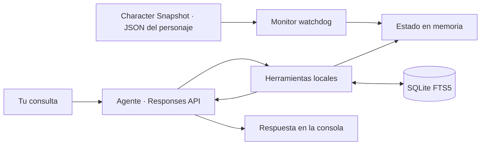

<div align="center">

# ⚔️ OSRS GPT Companion

**Español** · [English](README.en.md) · [Português (Brasil)](README.pt-BR.md)

**Tu personaje, tus objetivos y un agente que recuerda cómo te gusta jugar.**

Un asistente de consola para **Old School RuneScape**, construido en Python,
con estado exportado por el plugin **Character Snapshot** de RuneLite, memoria local y herramientas que el modelo
puede consultar durante la conversación.


[Inicio rápido](#-inicio-rápido) · [Funcionamiento](#-cómo-funciona) · [Herramientas](#-herramientas-del-agente) · [Próximos pasos](#-próximos-pasos)

</div>

---

## 🎮 ¿Qué puedes hacer?

Conversa sobre tu progreso y conserva tus preferencias entre sesiones:

> «Recuerda que quiero conseguir Quest Cape y prefiero evitar Wilderness.»
>
> «Revisa mis habilidades y misiones. ¿Qué objetivo debería completar después?»
>
> «¿Qué había guardado sobre Dragon Slayer?»

- **Estado actualizado en memoria:** observa el JSON exportado por **Character Snapshot** con `watchdog`.
- **Memoria persistente:** guarda y recupera metas o gustos mediante SQLite FTS5.
- **Invocación de herramientas:** el modelo puede consultar datos, revisar recuerdos y guardar preferencias antes de responder.
- **Sign in with ChatGPT:** autenticación OAuth local con PKCE, renovación de tokens y almacenamiento cifrado mediante Windows DPAPI.
- **Responses API:** transporte HTTP/SSE, con `store: false` y `stream: true`.

**La aplicación se ejecuta en tu PC; la inferencia se realiza en OpenAI.** El estado
y las memorias que consulta el modelo se envían como contexto de esas solicitudes.

La documentación está disponible en español, inglés y portugués de Brasil.
Los comandos, los mensajes de consola y el idioma predeterminado actual del
agente siguen en español.

## 🚀 Inicio rápido

### Requisitos

- Windows y Python **3.11 o posterior**.
- Git, para clonar el proyecto.
- Una cuenta elegible de ChatGPT con permiso para usar su plan mediante SIWC.
- RuneLite con el plugin **Character Snapshot** instalado y habilitado. Este repositorio no instala el plugin.
- El archivo JSON del personaje generado por Character Snapshot en la carpeta que elijas.

### Instalación

En PowerShell:

```powershell
git clone https://github.com/mauricio-castano-dev/osrs-gpt-companion.git
Set-Location osrs-gpt-companion

python -m venv .venv
.\.venv\Scripts\python.exe -m pip install -r requirements.txt
.\.venv\Scripts\python.exe main.py --init
```

No hace falta activar el entorno ni configurar `OPENAI_API_KEY`.

### Configura Character Snapshot y conecta tu personaje

1. En RuneLite, instala y habilita el plugin **Character Snapshot**.
2. Cuando el plugin pregunte por la carpeta de exportación, selecciona la que quieras utilizar. **La carpeta la eliges tú**; no hay que asumir una ubicación automática dentro de `.runelite`.
3. Localiza el JSON generado por el plugin. Su nombre es **el nombre del personaje seguido de `.json`**, no un nombre fijo del proyecto.
4. Ejecuta el asistente con `--state-file`, indicando la ruta completa a ese archivo.

Por ejemplo, si eliges `C:\OSRS\Snapshots` y tu personaje se llama
`ExamplePlayer`, el archivo será `C:\OSRS\Snapshots\ExamplePlayer.json`:

```powershell
.\.venv\Scripts\python.exe main.py --state-file 'C:\OSRS\Snapshots\ExamplePlayer.json'
```

Sustituye tanto la carpeta como `ExamplePlayer` por los valores de tu exportación.
El nombre del archivo no se deduce del usuario de Windows, del usuario de GitHub
ni del nombre del repositorio. Para varios personajes, indica el JSON del que
quieras consultar en cada sesión. Usa las comillas también si la ruta o el nombre
contienen espacios.

El primer uso abre el navegador para iniciar sesión y autorizar el uso del plan.
La elegibilidad, los modelos y los límites dependen de la cuenta y de los permisos concedidos.

Para comprobar la instalación con **datos ficticios**, sin iniciar sesión:

```powershell
.\.venv\Scripts\python.exe main.py --check-state --state-file .\examples\player.example.json
```

Los datos de `examples/player.example.json` son ficticios y solo sirven para
probar la instalación. Para usar tu estado real, inicia siempre con `--state-file`
apuntando al archivo `<nombre_del_personaje>.json` de la carpeta elegida en
Character Snapshot.

## 🧭 Cómo funciona



1. Character Snapshot exporta los datos a la carpeta elegida. El monitor carga el JSON indicado y actualiza la caché cuando detecta cambios, incluidos reemplazos completos.
2. Tu mensaje se envía al modelo junto con las instrucciones y los esquemas de herramientas.
3. El modelo puede solicitar una o varias funciones. Python valida los argumentos y ejecuta únicamente las funciones permitidas.
4. Los resultados vuelven al modelo mediante `function_call_output`, asociado al `call_id` original.
5. El ciclo continúa hasta una respuesta final, con límites de **8 rondas** y **24 llamadas** por turno.

Los cambios del archivo actualizan la caché; las consultas al modelo se realizan
durante tus turnos de chat. El monitor observa la última exportación disponible de Character Snapshot;
no comprueba por sí mismo que RuneLite siga conectado.

## 🛠 Herramientas del agente

Las funciones se agrupan en el namespace `osrs`, con esquemas JSON estrictos.

| Herramienta | Propósito |
| --- | --- |
| `get_live_state` | Consultar la instantánea del personaje antes de aconsejar sobre su progreso. |
| `save_user_preference` | Guardar metas, gustos y restricciones expresados por el usuario. |
| `recall_user_preference` | Recuperar recuerdos por palabras o frases concretas. |

La búsqueda usa **FTS5 por frase literal de tokens**: conserva nombres concretos
de objetos o misiones, admite consultas más cortas y devuelve hasta ocho resultados.
No es una búsqueda semántica ni una consulta a internet.

## ⌨️ Comandos

| Comando | Acción |
| --- | --- |
| `/salir` | Cierra la consola y conserva la sesión de autenticación. |
| `/limpiar` | Limpia el historial de chat en memoria; conserva los recuerdos de SQLite. |
| `/uso` | Abre los controles de uso de ChatGPT. |
| `/logout` | Intenta revocar la sesión y elimina los tokens locales. |

```powershell
# Iniciar sesión o reautorizar
.\.venv\Scripts\python.exe main.py --login

# Ver los modelos disponibles para tu cuenta
.\.venv\Scripts\python.exe main.py --models

# Elegir un modelo y el archivo del personaje
.\.venv\Scripts\python.exe main.py --model SLUG --state-file 'C:\OSRS\Snapshots\ExamplePlayer.json'

# Comprobar el JSON sin consultar al modelo
.\.venv\Scripts\python.exe main.py --check-state --state-file 'C:\OSRS\Snapshots\ExamplePlayer.json'
```

## 🗂 Estructura

```text
osrs-gpt-companion/
├── auth.py              # OAuth, PKCE, identidad, DPAPI y renovación
├── main.py              # Consola y ciclo de vida del monitor
├── inference.py         # Responses API, SSE y ciclo de herramientas
├── state_monitor.py     # Caché del JSON y eventos del sistema de archivos
├── memory_db.py         # Memoria persistente SQLite FTS5
├── tools.py             # Esquemas y ejecución de funciones permitidas
├── osrs_reader.py       # Lector anterior conservado por compatibilidad
├── test_agent.py        # Pruebas del agente y del monitor
├── test_companion.py    # Pruebas de autenticación y compatibilidad
├── examples/
│   └── player.example.json
├── requirements.txt
├── README.md            # Español
├── README.en.md         # Inglés
├── README.pt-BR.md      # Portugués de Brasil
└── CHANGELOG.md
```

## 🔐 Datos locales

| Ubicación | Contenido |
| --- | --- |
| `.auth/host.json` | Identificador persistente de la instalación. |
| `.auth/profile.dpapi` | Credenciales cifradas para el usuario actual de Windows. |
| `memories.sqlite3` | Metas y preferencias persistentes; **sin cifrado**. |
| `<nombre_del_personaje>.json` | Datos exportados por Character Snapshot en la carpeta que seleccionaste. |

Git excluye credenciales, bases de datos locales, archivos de personajes,
entornos de Python y copias de seguridad. Los ejemplos publicados son ficticios.
El historial conserva los últimos seis intercambios únicamente en memoria.
La memoria persistente guarda lo que se solicita a la herramienta, no una
transcripción automática de toda la conversación.

`store: false` es un parámetro de la API; no implica que la inferencia ocurra
sin conexión ni que los resultados de herramientas permanezcan únicamente en tu PC.

## 🧪 Pruebas

```powershell
.\.venv\Scripts\python.exe -m unittest -v
```

Las pruebas utilizan archivos temporales, tokens ficticios y respuestas simuladas;
no necesitan una sesión de ChatGPT ni consumen el plan. Verifican el monitor,
SQLite FTS5, autenticación, argumentos de herramientas, límites de ejecución y SSE.
Las pruebas de DPAPI requieren acceso al perfil de cifrado del usuario de Windows.

El cliente admite conexiones que omiten `Content-Type` si el cuerpo contiene
eventos SSE válidos. Rechaza eventos malformados y respuestas sin confirmación
de finalización; las llamadas de herramientas incompletas no se ejecutan.

## 📌 Alcance de esta primera iteración

- Interfaz de consola para Windows y un perfil ChatGPT por instalación.
- El archivo debe ser un objeto JSON de hasta **1 MiB**.
- `get_live_state` devuelve actualmente la instantánea completa: un banco grande
  incrementa el contexto y el consumo al reenviarse durante el turno.
- Los cambios de preferencias se guardan como nuevos registros fechados.
- Si una consulta falla, las memorias ya guardadas se conservan y no se reintenta automáticamente.
- Las descripciones indican al modelo cuándo consultar el estado; no constituyen una garantía de que lo haga en toda respuesta.
- Todavía no incluye consultas web, OSRS Wiki, precios actuales ni control del juego.

## 🗺 Próximos pasos

- [ ] Consultas granulares de habilidades, objetos y misiones para reducir contexto.
- [ ] Integración de consulta con OSRS Wiki y precios del Grand Exchange.
- [ ] Selección de personaje y configuración persistente de rutas.
- [ ] Gestión de memorias: listar, actualizar y eliminar preferencias.
- [ ] Mejor visibilidad del uso y del estado de actualización de RuneLite.

Estas tareas son planes de evolución y no funcionalidades incluidas.

## 🤝 Desarrollo y documentación

Las mejoras de comportamiento deben incluir pruebas relevantes y actualizar
las tres versiones del README y el [historial de cambios](CHANGELOG.md).
La versión en español es la referencia. Cada traducción describe lo que funciona
en la versión actual; las propuestas permanecen en la hoja de ruta.

Al reportar un problema, incluye el comando, el mensaje de error y la versión
de Python. Comparte únicamente ejemplos ficticios o datos que quieras hacer públicos.

## 📚 Referencias

- [Sign in with ChatGPT: registro e inicio de sesión](https://developers.openai.com/siwc/token-sharing-open-source/sign-in)
- [SIWC: modelos e inferencia](https://developers.openai.com/siwc/token-sharing-open-source/models-and-inference)
- [SIWC: restricciones actuales](https://developers.openai.com/siwc/token-sharing-open-source/preview-limitations)
- [Responses API: function calling](https://developers.openai.com/api/docs/guides/function-calling)
- [watchdog](https://python-watchdog.readthedocs.io/en/stable/quickstart.html)
- [SQLite FTS5](https://www.sqlite.org/fts5.html)

---

Proyecto independiente, sin afiliación oficial con Jagex u OpenAI.
