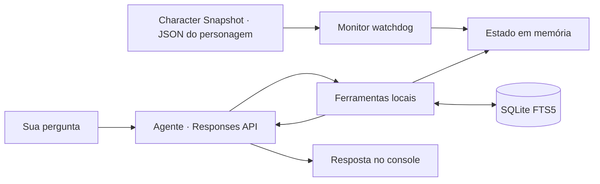

<div align="center">

# ⚔️ OSRS GPT Companion

[Español](README.md) · [English](README.en.md) · **Português (Brasil)**

**Seu personagem, seus objetivos e um agente que lembra como você gosta de jogar.**

Um assistente de console para **Old School RuneScape**, desenvolvido em Python,
com dados exportados pelo plugin **Character Snapshot** do RuneLite, memória
local e ferramentas que o modelo pode consultar durante a conversa.


[Início rápido](#-início-rápido) · [Funcionamento](#-como-funciona) · [Ferramentas](#-ferramentas-do-agente) · [Próximos passos](#-próximos-passos)

</div>

---

## 🎮 O que você pode fazer?

Converse sobre seu progresso e mantenha suas preferências entre sessões:

> “Lembre que quero conseguir a Quest Cape e prefiro evitar a Wilderness.”
>
> “Confira minhas habilidades e missões. Qual objetivo devo completar a seguir?”
>
> “O que eu tinha salvo sobre Dragon Slayer?”

- **Estado atualizado em memória:** acompanha o JSON exportado pelo **Character Snapshot** com `watchdog`.
- **Memória persistente:** salva e recupera metas e preferências com SQLite FTS5.
- **Chamada de ferramentas:** o modelo pode consultar dados, recuperar memórias e salvar preferências antes de responder.
- **Sign in with ChatGPT:** autenticação OAuth local com PKCE, renovação de tokens e armazenamento criptografado pelo Windows DPAPI.
- **Responses API:** transporte HTTP/SSE com `store: false` e `stream: true`.

**O aplicativo roda no seu PC; a inferência acontece na OpenAI.** O estado e as
memórias consultados pelo modelo são enviados como contexto dessas solicitações.

Esta tradução abrange a documentação. Os comandos, as mensagens do console e
o idioma padrão atual do agente continuam em espanhol.

## 🚀 Início rápido

### Requisitos

- Windows e Python **3.11 ou posterior**.
- Git para clonar o projeto.
- Uma conta elegível do ChatGPT com permissão para usar o plano por meio de SIWC.
- RuneLite com o plugin **Character Snapshot** instalado e ativado. Este repositório não instala o plugin.
- O JSON do personagem gerado pelo Character Snapshot na pasta que você escolher.

### Instalação

No PowerShell:

```powershell
git clone https://github.com/mauricio-castano-dev/osrs-gpt-companion.git
Set-Location osrs-gpt-companion

python -m venv .venv
.\.venv\Scripts\python.exe -m pip install -r requirements.txt
.\.venv\Scripts\python.exe main.py --init
```

Não é necessário ativar o ambiente nem configurar `OPENAI_API_KEY`.

### Configure o Character Snapshot e conecte seu personagem

1. Instale e ative o plugin **Character Snapshot** no RuneLite.
2. Quando o plugin solicitar a pasta de exportação, selecione a que deseja usar. **Você escolhe a pasta**; não presuma uma localização automática dentro de `.runelite`.
3. Localize o JSON exportado. O nome do arquivo é **o nome do personagem seguido de `.json`**, e não um nome fixo do projeto.
4. Inicie o assistente com `--state-file`, informando o caminho completo desse arquivo.

Por exemplo, se você escolher `C:\OSRS\Snapshots` e seu personagem se chamar
`ExamplePlayer`, o arquivo será `C:\OSRS\Snapshots\ExamplePlayer.json`:

```powershell
.\.venv\Scripts\python.exe main.py --state-file 'C:\OSRS\Snapshots\ExamplePlayer.json'
```

Substitua a pasta e `ExamplePlayer` pelos valores da sua exportação. O nome do
arquivo não é derivado do usuário do Windows, do usuário do GitHub nem do nome
do repositório. Para vários personagens, informe o JSON desejado em cada sessão.
Mantenha as aspas quando o caminho ou o nome tiver espaços.

No primeiro uso, o navegador será aberto para entrar na conta e autorizar o uso
do plano. Elegibilidade, modelos e limites dependem da conta e das permissões concedidas.

Para verificar a instalação com **dados fictícios**, sem entrar na conta:

```powershell
.\.venv\Scripts\python.exe main.py --check-state --state-file .\examples\player.example.json
```

`examples/player.example.json` contém dados fictícios apenas para verificar a
instalação. Para usar seu estado real, inicie sempre com `--state-file` apontando
para `<nome_do_personagem>.json` na pasta escolhida no Character Snapshot.

## 🧭 Como funciona



1. O Character Snapshot exporta os dados para a pasta escolhida. O monitor carrega o JSON indicado e atualiza o cache ao detectar alterações, inclusive substituições completas do arquivo.
2. Sua mensagem é enviada ao modelo com instruções e esquemas de ferramentas.
3. O modelo pode solicitar uma ou mais funções. O Python valida os argumentos e executa somente as funções permitidas.
4. Os resultados retornam por `function_call_output`, associado ao `call_id` original.
5. O ciclo continua até uma resposta final, com limites de **8 rodadas** e **24 chamadas** por turno.

As alterações do arquivo atualizam o cache; as consultas ao modelo acontecem
durante seus turnos de conversa. O monitor acompanha a última exportação
disponível do Character Snapshot, sem verificar por conta própria se o RuneLite
continua conectado.

## 🛠 Ferramentas do agente

As funções ficam no namespace `osrs`, com esquemas JSON estritos.

| Ferramenta | Finalidade |
| --- | --- |
| `get_live_state` | Consultar o estado do personagem antes de aconselhar sobre seu progresso. |
| `save_user_preference` | Salvar metas, preferências e restrições expressas pelo usuário. |
| `recall_user_preference` | Recuperar memórias por palavras ou frases específicas. |

A busca usa **FTS5 por frase literal de tokens**: preserve os nomes específicos
de itens ou missões, tente consultas mais curtas quando necessário e receba até
oito resultados. Não é uma busca semântica nem uma consulta à internet.

## ⌨️ Comandos

| Comando | Ação |
| --- | --- |
| `/salir` | Fecha o console e mantém a sessão de autenticação. |
| `/limpiar` | Limpa o histórico em memória; preserva as memórias do SQLite. |
| `/uso` | Abre os controles de uso do ChatGPT. |
| `/logout` | Tenta revogar a sessão e remove os tokens locais. |

```powershell
# Entrar ou autorizar novamente
.\.venv\Scripts\python.exe main.py --login

# Listar os modelos disponíveis para sua conta
.\.venv\Scripts\python.exe main.py --models

# Escolher um modelo e o arquivo do personagem
.\.venv\Scripts\python.exe main.py --model SLUG --state-file 'C:\OSRS\Snapshots\ExamplePlayer.json'

# Validar o JSON sem consultar o modelo
.\.venv\Scripts\python.exe main.py --check-state --state-file 'C:\OSRS\Snapshots\ExamplePlayer.json'
```

## 🗂 Estrutura do projeto

```text
osrs-gpt-companion/
├── auth.py              # OAuth, PKCE, identidade, DPAPI e renovação
├── main.py              # Console e ciclo de vida do monitor
├── inference.py         # Responses API, SSE e ciclo de ferramentas
├── state_monitor.py     # Cache do JSON e eventos de arquivos
├── memory_db.py         # Memória persistente SQLite FTS5
├── tools.py             # Esquemas e execução das funções permitidas
├── osrs_reader.py       # Leitor anterior mantido por compatibilidade
├── test_agent.py        # Testes do agente e do monitor
├── test_companion.py    # Testes de autenticação e compatibilidade
├── examples/
│   └── player.example.json
├── requirements.txt
├── README.md            # Espanhol
├── README.en.md         # Inglês
├── README.pt-BR.md      # Português do Brasil
└── CHANGELOG.md
```

## 🔐 Dados locais

| Localização | Conteúdo |
| --- | --- |
| `.auth/host.json` | Identificador persistente da instalação. |
| `.auth/profile.dpapi` | Credenciais criptografadas para o usuário atual do Windows. |
| `memories.sqlite3` | Metas e preferências persistentes; **sem criptografia**. |
| `<nome_do_personagem>.json` | Dados exportados pelo Character Snapshot na pasta escolhida. |

O Git exclui credenciais, bancos de dados locais, arquivos dos personagens,
ambientes Python e backups. Os exemplos publicados são fictícios. O histórico
mantém as últimas seis trocas apenas em memória. A memória persistente armazena
o que é enviado à ferramenta; não grava automaticamente uma transcrição de
todas as conversas.

`store: false` é um parâmetro da API. Isso não significa que a inferência aconteça
offline ou que os resultados das ferramentas permaneçam exclusivamente no seu PC.

## 🧪 Testes

```powershell
.\.venv\Scripts\python.exe -m unittest -v
```

Os testes usam arquivos temporários, tokens fictícios e respostas simuladas.
Não precisam de uma sessão do ChatGPT nem consomem seu plano. Verificam o monitor,
SQLite FTS5, autenticação, argumentos de ferramentas, limites de execução e SSE.
Os testes de DPAPI precisam de acesso ao perfil de criptografia do usuário do Windows.

O cliente aceita conexões que omitem `Content-Type` quando o corpo contém eventos
SSE válidos. Rejeita eventos malformados e respostas sem confirmação de conclusão;
chamadas incompletas de ferramentas não são executadas.

## 📌 Alcance desta primeira iteração

- Interface de console para Windows e um perfil do ChatGPT por instalação.
- O arquivo deve conter um objeto JSON de até **1 MiB**.
- `get_live_state` retorna atualmente o estado completo: um banco grande aumenta o contexto e o consumo quando é reenviado durante o turno.
- Mudanças de preferência são salvas como novos registros com data.
- Consultas com falha não são repetidas automaticamente; memórias já salvas são preservadas.
- As descrições orientam o modelo sobre quando consultar o estado, mas não garantem que ele faça isso em toda resposta.
- Consultas web, OSRS Wiki, preços atuais e controle do jogo ainda não estão incluídos.

## 🗺 Próximos passos

- [ ] Consultas específicas de habilidades, itens e missões para reduzir o contexto.
- [ ] Integração de consultas à OSRS Wiki e aos preços do Grand Exchange.
- [ ] Seleção de personagem e configuração persistente de caminhos.
- [ ] Gerenciamento de memórias: listar, atualizar e excluir preferências.
- [ ] Mais visibilidade sobre o uso e o estado de atualização do RuneLite.

São melhorias planejadas, e não funcionalidades incluídas.

## 🤝 Desenvolvimento e documentação

Mudanças de comportamento devem incluir testes relevantes e atualizações das
três versões do README e do [histórico de mudanças](CHANGELOG.md), atualmente
mantido em espanhol. O README em espanhol é a versão de referência. Cada
tradução deve descrever o funcionamento atual; propostas ficam na lista de
próximos passos.

Ao relatar um problema, informe o comando, a mensagem de erro e a versão do
Python. Compartilhe apenas exemplos fictícios ou dados que deseja tornar públicos.

## 📚 Referências

- [Sign in with ChatGPT: registro e autenticação](https://developers.openai.com/siwc/token-sharing-open-source/sign-in)
- [SIWC: modelos e inferência](https://developers.openai.com/siwc/token-sharing-open-source/models-and-inference)
- [SIWC: limitações atuais](https://developers.openai.com/siwc/token-sharing-open-source/preview-limitations)
- [Responses API: function calling](https://developers.openai.com/api/docs/guides/function-calling)
- [watchdog](https://python-watchdog.readthedocs.io/en/stable/quickstart.html)
- [SQLite FTS5](https://www.sqlite.org/fts5.html)

---

Projeto independente, sem afiliação oficial com a Jagex ou a OpenAI.
