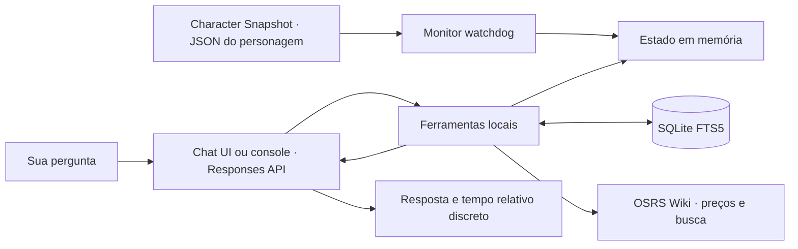

<div align="center">

# ⚔️ OSRS GPT Companion

[Español](README.md) · [English](README.en.md) · **Português (Brasil)**

**Seu personagem, seus objetivos e um agente que lembra como você gosta de jogar.**

Um assistente para **Old School RuneScape**, com interface local no estilo OSRS e console, desenvolvido em Python,
com dados exportados pelo plugin **Character Snapshot** do RuneLite, memória
local e ferramentas que o modelo pode consultar durante a conversa.


[Início rápido](#-início-rápido) · [Funcionamento](#-como-funciona) · [Ferramentas](#-ferramentas-do-agente) · [Próximos passos](#-próximos-passos)

</div>

---

## 🎮 O que você pode fazer?

Converse sobre seu progresso e mantenha suas preferências entre sessões:

> “Lembre que quero conseguir a Quest Cape e prefiro evitar a Wilderness.”
>
> “Confira minhas habilidades e missões. Qual objetivo devo completar a seguir?”
>
> “O que eu tinha salvo sobre Dragon Slayer?”
>
> “Consulte o preço de Abyssal whip e verifique os requisitos de Dragon Slayer II na wiki.”

- **Estado atualizado e filtrado:** acompanha o JSON do **Character Snapshot** com `watchdog` e consulta apenas os dados necessários.
- **Memória persistente:** salva metas e preferências no SQLite FTS5, com busca flexível por tokens.
- **Sete ferramentas:** consultas específicas do personagem, preços do Grand Exchange, OSRS Wiki e memória persistente.
- **Sign in with ChatGPT:** autenticação OAuth local com PKCE, renovação de tokens e armazenamento criptografado pelo Windows DPAPI.
- **Responses API:** transporte HTTP/SSE com `store: false` e `stream: true`.

**O aplicativo roda no seu PC; a inferência acontece na OpenAI.** O estado e as
memórias consultados pelo modelo são enviados como contexto dessas solicitações.
As ferramentas do personagem enviam resultados filtrados, nunca o JSON completo.
Buscas na wiki e nomes de itens são enviados às APIs públicas da OSRS Wiki.

Esta tradução abrange a documentação. Os comandos, as mensagens do console e
o idioma padrão atual do agente continuam em espanhol.

## 🚀 Início rápido

### Requisitos

- Windows e Python **3.11 ou posterior**.
- Git para clonar o projeto.
- Uma conta elegível do ChatGPT com permissão para usar o plano por meio de SIWC.
- RuneLite com o plugin **Character Snapshot** instalado e ativado. Este repositório não instala o plugin.
- O JSON do personagem gerado pelo Character Snapshot na pasta que você escolher.

### Instalação

No PowerShell:

```powershell
git clone https://github.com/mauricio-castano-dev/osrs-gpt-companion.git
Set-Location osrs-gpt-companion

python -m venv .venv
.\.venv\Scripts\python.exe -m pip install -e .
.\.venv\Scripts\python.exe main.py --install-path
```

Não é necessário ativar o ambiente nem configurar `OPENAI_API_KEY`.

### Inicie de qualquer pasta

Depois de instalar os lançadores, **abra um novo terminal** para que o Windows
carregue o PATH atualizado. De qualquer pasta, use:

```powershell
osrs-companion
osrs-companion-ui
osrs-companion --cli
```

`osrs-companion` abre a interface no navegador por padrão. `--cli` mantém o chat
de console disponível. Você também pode clicar duas vezes em `osrs-companion-ui.cmd`
na pasta do projeto. Os lançadores usam caminhos absolutos para o Python de
`.venv` e `main.py`, e também são instalados em `%LOCALAPPDATA%\OSRSGPTCompanion\bin`.
O instalador adiciona essa pasta ao PATH do usuário sem duplicatas e preserva
as outras entradas. Se mover o projeto, execute a instalação novamente.

### Configure o Character Snapshot e conecte seu personagem

1. Instale e ative o plugin **Character Snapshot** no RuneLite.
2. Quando o plugin solicitar a pasta de exportação, selecione a que deseja usar. **Você escolhe a pasta**; não presuma uma localização automática dentro de `.runelite`.
3. Localize o JSON exportado. O nome do arquivo é **o nome do personagem seguido de `.json`**, e não um nome fixo do projeto.
4. Inicie o assistente com `--state-file`, informando o caminho completo desse arquivo.

Por exemplo, se você escolher `C:\OSRS\Snapshots` e seu personagem se chamar
`ExamplePlayer`, o arquivo será `C:\OSRS\Snapshots\ExamplePlayer.json`:

```powershell
osrs-companion --state-file 'C:\OSRS\Snapshots\ExamplePlayer.json'
```

Substitua a pasta e `ExamplePlayer` pelos valores da sua exportação. O nome do
arquivo não é derivado do usuário do Windows, do usuário do GitHub nem do nome
do repositório. Para vários personagens, informe o JSON desejado em cada sessão.
Mantenha as aspas quando o caminho ou o nome tiver espaços.

No primeiro uso, o navegador será aberto para entrar na conta e autorizar o uso
do plano. Elegibilidade, modelos e limites dependem da conta e das permissões concedidas.

Para verificar a instalação com **dados fictícios**, sem entrar na conta:

```powershell
osrs-companion --check-state --state-file .\examples\player.example.json
```

`examples/player.example.json` contém dados fictícios apenas para verificar a
instalação. Para usar seu estado real pela primeira vez, passe `--state-file`
apontando para `<nome_do_personagem>.json` na pasta escolhida no Character Snapshot.
O último caminho válido selecionado explicitamente fica salvo para as próximas sessões.

## 🧭 Como funciona



1. O Character Snapshot exporta os dados para a pasta escolhida. O monitor carrega o JSON indicado e atualiza o cache ao detectar alterações, inclusive substituições completas do arquivo.
2. Sua mensagem é enviada ao modelo com instruções e esquemas de ferramentas.
3. O modelo pode solicitar uma ou mais funções. O Python valida os argumentos e executa somente as funções permitidas.
4. Resultados filtrados, memórias ou dados externos retornam por `function_call_output`, associado ao `call_id` original. O JSON completo do personagem nunca é enviado ao modelo.
5. O ciclo continua até uma resposta final, com limites de **8 rodadas** e **24 chamadas** por turno.

As alterações do arquivo atualizam o cache; as consultas ao modelo acontecem
durante seus turnos de conversa. O monitor acompanha a última exportação
disponível do Character Snapshot, sem verificar por conta própria se o RuneLite
continua conectado.

## 🛠 Ferramentas do agente

As funções ficam no namespace `osrs`, com esquemas JSON estritos.

| Ferramenta | Finalidade |
| --- | --- |
| `query_player_stats` | Habilidades, mundo, quick prayers e estado vital; extras opcionais de farming ativo, birdhouses, orações desbloqueadas, KC, POH, transporte e minijogos. |
| `query_player_bank` | Buscar itens e consultar equipamento e liquidez; `source=all` ou `bank` inclui até oito ofertas pessoais do GE. |
| `query_quests_and_diaries` | Missões, diários e `combat_achievements`: resumo por nível e até 25 tarefas de combate somente com uma busca específica. |
| `check_ge_price` | Consultar preços observados do Grand Exchange e a data de cada observação. |
| `search_osrs_wiki` | Buscar páginas da OSRS Wiki e consultar uma introdução verificável com seu link. |
| `save_agent_memory` | Salvar metas, preferências e planos expressos pelo usuário. |
| `recall_agent_memory` | Recuperar memórias por palavras-chave, primeiro com AND e depois com OR. |

A busca de memória usa **tokens Unicode seguros**. Primeiro exige todos
os termos (`AND`); sem resultados, procura qualquer termo (`OR`). As palavras
não precisam estar juntas. Retorna até oito memórias por relevância e data;
o agente deve verificar a pertinência das correspondências parciais.

As consultas do personagem usam o cache em RAM. Os resultados incluem `ok`,
datas de atualização e limites: até **30 itens do banco**, **40 missões** e
**30 tarefas por região**. Uma busca vazia não lista o banco. Diários sem busca
mostram apenas o estado dos níveis. Valores ausentes são distintos de zero conhecido.

Os preços vêm da API da OSRS Wiki, com até cinco correspondências e suas datas.
O catálogo de itens fica em RAM por **seis horas**. A busca na wiki retorna até
três links e a introdução da primeira página em texto simples, com um orçamento
total de **2.500 bytes**. Segue redirecionamentos; introduções com menos de
250 caracteres geram uma consulta adicional às primeiras seções. O extrato ainda
pode omitir requisitos ou tabelas de drops. As chamadas usam um `User-Agent` descritivo e uma sessão sem credenciais da OpenAI.


### Farming e progresso adicional

Com `include_slayer_and_timers=true`, farming filtra os canteiros ativos antes
de aplicar o limite: omite `EMPTY`, `Weeds` e `Compost Bin`, retornando até
**25 canteiros** com `active_count`, `empty_omitted_count`, `total_patches` e
`truncated`. Plantações `HARVESTABLE`, `DEAD` ou `GROWING` deixam de ficar ocultas
atrás de canteiros vazios. Até oito birdhouses estruturadas são preservadas
integralmente. Formatos antigos de timers mantêm o resumo genérico de até 12 entradas.

Os extras incluem `killCounts`, `activityCounts`, `minigamePoints`, `house`,
`transport` e `location`. Orações desbloqueadas aparecem em `prayers`, fora de
`player`. As ofertas do GE pertencem ao personagem e são exportadas pelo
Character Snapshot; não substituem a consulta de preços atuais do mercado.

Para Combat Achievements, use `category="combat_achievements"`. Sem `search_term`,
apenas o resumo dos seis níveis e os pontos são retornados. Uma busca por tarefa,
monstro ou nível retorna até **25 tarefas**, respeitando `status_filter`.
`category="all"` também inclui o resumo. O catálogo completo nunca é enviado.

## ⌨️ Comandos

| Comando | Ação |
| --- | --- |
| `/salir` | Fecha o console e mantém a sessão de autenticação. |
| `/estado` | Mostra um resumo local do personagem, atualização, GP e canteiros ativos, sem consultar o modelo. |
| `/memorias` | Lista as últimas 20 memórias com IDs e datas, sem consultar o modelo. |
| `/olvidar ID` | Exclui uma memória local pelo ID e informa se existia; sem chamada ao modelo. |
| `/limpiar` | Limpa o histórico em memória; preserva as memórias do SQLite. |
| `/uso` | Abre os controles de uso do ChatGPT. |
| `/logout` | Tenta revogar a sessão e remove os tokens locais. |

```powershell
# Entrar ou autorizar novamente
osrs-companion --login

# Listar os modelos disponíveis para sua conta
osrs-companion --models

# Escolher um modelo e o arquivo do personagem
osrs-companion --model SLUG --state-file 'C:\OSRS\Snapshots\ExamplePlayer.json'

# Validar o JSON sem consultar o modelo
osrs-companion --check-state --state-file 'C:\OSRS\Snapshots\ExamplePlayer.json'
```


### Comandos locais e preferências de inicialização

`/estado` mostra cinco linhas com `ok`, `lastUpdated`, nome, nível de combate,
mundo, GP equivalentes no banco/inventário e quantidade de canteiros ativos.
Se o estado estiver indisponível, informa isso sem apresentar valores antigos
como atuais. `/memorias` mostra `[#id] (created_at) tema: contenido`;
`/olvidar 3` exclui a memória com ID 3 ou informa que ela não existe. Esses
comandos não geram inferências nem entram no histórico enviado ao modelo.
O catálogo de modelos e a autenticação ainda podem acessar a rede ao iniciar.

As opções explícitas `--state-file` e `--model` têm prioridade sobre os valores
salvos em `.auth/settings.json`. Um caminho só é salvo após o JSON carregar
corretamente; `--check-state --state-file ...` também permite salvá-lo sem
consultar a OpenAI. O modelo é salvo após validação no catálogo. Se o caminho
salvo não existir mais, usa-se o caminho padrão de compatibilidade. Se o modelo
salvo não estiver disponível, seleciona-se o primeiro do catálogo. Esses valores
de fallback não substituem suas escolhas salvas. Configurações corrompidas são
ignoradas e podem ser substituídas por opções válidas.

Depois de escolher o caminho e o modelo, você pode iniciar com:

```powershell
osrs-companion
```

### Visibilidade de ferramentas e gancho para interface

O console mostra `[Consultando herramienta: query_player_stats]` com o nome
validado de cada chamada nova. `answer(question, model, history, router,
on_tool_call=None)` aceita um observador opcional que recebe `(tool_name,
ok_status)` após a execução. Erros estruturados informam `False`; um salvamento
duplicado já satisfeito continua sendo sucesso. Nomes desconhecidos usam o rótulo
de ferramenta local e informam `local`. Os argumentos não são registrados.
Chamadas repetidas com o mesmo ID não são executadas nem notificadas novamente.
Falhas do observador são informadas sem interromper o turno. A interface OSRS
usa esse gancho para os chips de ferramentas de cada resposta.

### Interface OSRS e idade do reporte

O HUD mostra personagem, combate, mundo, Quest Points, GP, habilidades, farming
e birdhouses. Atualiza a cada **3 segundos** pela API local, sem consultar o
modelo. Plantações prontas aparecem em verde, crescendo em âmbar e mortas em
vermelho. A aba de memórias permite esquecer um registro com `✕`.

O chat oferece formatação simples, links, blocos de código, chips de ferramentas,
Enter para enviar e Shift + Enter para outra linha. Limpar o chat preserva as
memórias SQLite. As respostas devem ser concisas; timestamps ficam fora do texto
do modelo, exceto quando você perguntar ou o estado estiver indisponível. O
console adiciona um rodapé discreto `↳ Instantánea: hace 8 s`; a UI usa texto
pequeno com 50–55 % de opacidade.

O endereço padrão é `http://127.0.0.1:8765`; se estiver ocupado, usa uma porta
livre. Escolha com `--port 9000` ou use `--port 0` para alocação automática.
O servidor aceita apenas conexões loopback, valida Host e Origin, exige token
CSRF de sessão em POST/DELETE e não habilita CORS externo. Não exponha esta
interface de desktop por redirecionamento de portas.

| Endpoint local | Ação |
| --- | --- |
| `GET /api/status` | Estado filtrado em RAM, modelo, caminho e tempo relativo; sem inferência. |
| `GET /api/memories` | Últimas 30 memórias locais. |
| `POST /api/memories/delete` | Exclui `{ "id": 3 }`, com token CSRF. |
| `POST /api/chat` | Envia `{ "message": "..." }`; recebe resposta, ferramentas e idade do reporte. |

O histórico do chat é serializado com um lock; uma segunda consulta simultânea
retorna 409. O histórico é temporário e se perde ao fechar o servidor. APIs e
páginas usam `Cache-Control: no-store`. Tokens da OpenAI não chegam ao navegador;
o token CSRF é independente e existe apenas durante a sessão local do servidor.

## 🗂 Estrutura do projeto

```text
osrs-gpt-companion/
├── auth.py              # OAuth, PKCE, identidade, DPAPI e renovação
├── web_app.py           # Loopback API + CSRF
├── launcher.py          # Windows PATH
├── pyproject.toml       # Console entry points
├── ui/                  # HTML / CSS / JS
├── test_web_app.py      # Local API tests
├── test_app_shell.py    # Freshness + launchers
├── main.py              # Console e ciclo de vida do monitor
├── inference.py         # Responses API, SSE e ciclo de ferramentas
├── state_monitor.py     # Cache do JSON e eventos de arquivos
├── memory_db.py         # Memória persistente SQLite FTS5
├── tools.py             # Esquemas e execução das sete ferramentas
├── wiki_client.py       # Preços, busca e cache do catálogo
├── osrs_reader.py       # Leitor anterior mantido por compatibilidade
├── test_agent.py        # Testes do agente e do monitor
├── test_queries.py      # Filtros, limites, rotas e busca FTS5
├── test_wiki_client.py  # APIs simuladas, cache e User-Agent
├── test_companion.py    # Testes de autenticação e compatibilidade
├── examples/
│   └── player.example.json
├── requirements.txt
├── README.md            # Espanhol
├── README.en.md         # Inglês
├── README.pt-BR.md      # Português do Brasil
└── CHANGELOG.md
```

## 🔐 Dados locais

| Localização | Conteúdo |
| --- | --- |
| `.auth/host.json` | Identificador persistente da instalação. |
| `.auth/profile.dpapi` | Credenciais criptografadas para o usuário atual do Windows. |
| `.auth/settings.json` | Último caminho de estado válido e modelo escolhidos explicitamente pela CLI; gravação atômica. |
| `memories.sqlite3` | Metas e preferências persistentes; **sem criptografia**. |
| Cache do catálogo | Mapping de itens da OSRS Wiki em RAM; expira após seis horas. |
| `<nome_do_personagem>.json` | Dados exportados pelo Character Snapshot na pasta escolhida. |

O Git exclui credenciais, bancos de dados locais, arquivos dos personagens,
ambientes Python e backups. Os exemplos publicados são fictícios. O histórico
mantém as últimas seis trocas apenas em memória. A memória persistente armazena
o que é enviado à ferramenta; não grava automaticamente uma transcrição de
todas as conversas.

`store: false` é um parâmetro da API. Isso não significa que a inferência aconteça
offline ou que os resultados das ferramentas permaneçam exclusivamente no seu PC.

## 🧪 Testes

```powershell
.\.venv\Scripts\python.exe -m unittest -v
```

Os testes usam arquivos temporários, tokens fictícios e respostas simuladas.
Não precisam de uma sessão do ChatGPT nem consomem seu plano. Verificam o monitor,
SQLite FTS5 por tokens, filtros e limites de resultados, autenticação, argumentos
de ferramentas, limites de execução e SSE. As APIs externas são simuladas para
verificar `User-Agent`, cache, datas, extratos e erros sem acesso à rede.
Os testes de DPAPI precisam de acesso ao perfil de criptografia do usuário do Windows.

O cliente aceita conexões que omitem `Content-Type` quando o corpo contém eventos
SSE válidos. Rejeita eventos malformados e respostas sem confirmação de conclusão;
chamadas incompletas de ferramentas não são executadas.

## 📌 Alcance atual

- Interface local no estilo OSRS e console para Windows; um perfil do ChatGPT por instalação.
- O arquivo deve conter um objeto JSON de até **1 MiB**.
- As ferramentas expõem resultados filtrados. `snapshot()` permanece disponível para verificações locais e não é exposto ao modelo. Os resultados necessários continuam sendo reenviados durante o turno com `store: false`.
- Mudanças de preferência são salvas como novos registros com data.
- Consultas com falha não são repetidas automaticamente; memórias já salvas são preservadas.
- As descrições orientam o modelo sobre quando consultar o estado, mas não garantem que ele faça isso em toda resposta.
- As consultas externas se limitam à OSRS Wiki e à sua API de preços; não há navegação web geral nem controle do jogo.
- Falhas de API retornam erros explícitos; o agente deve reconhecer que não conseguiu verificar o dado.

## 🗺 Próximos passos

- [x] Consultas específicas de habilidades, itens e missões para reduzir o contexto.
- [x] Integração de consultas à OSRS Wiki e aos preços do Grand Exchange.
- [x] Seleção do arquivo do personagem pela CLI e persistência de caminho/modelo.
- [x] Listagem e exclusão local de memórias por ID.
- [ ] Edição direta de memórias existentes.
- [x] Nomes das ferramentas executadas, callback para UI e consulta local do estado.
- [ ] Métricas detalhadas de consumo por consulta.

As tarefas marcadas estão implementadas; as pendentes são melhorias planejadas.

## 🤝 Desenvolvimento e documentação

Mudanças de comportamento devem incluir testes relevantes e atualizações das
três versões do README e do [histórico de mudanças](CHANGELOG.md), atualmente
mantido em espanhol. O README em espanhol é a versão de referência. Cada
tradução deve descrever o funcionamento atual; propostas ficam na lista de
próximos passos.

Ao relatar um problema, informe o comando, a mensagem de erro e a versão do
Python. Compartilhe apenas exemplos fictícios ou dados que deseja tornar públicos.

## 📚 Referências

- [Sign in with ChatGPT: registro e autenticação](https://developers.openai.com/siwc/token-sharing-open-source/sign-in)
- [SIWC: modelos e inferência](https://developers.openai.com/siwc/token-sharing-open-source/models-and-inference)
- [SIWC: limitações atuais](https://developers.openai.com/siwc/token-sharing-open-source/preview-limitations)
- [Responses API: function calling](https://developers.openai.com/api/docs/guides/function-calling)
- [watchdog](https://python-watchdog.readthedocs.io/en/stable/quickstart.html)
- [SQLite FTS5](https://www.sqlite.org/fts5.html)
- [OSRS Wiki: Real-time Prices](https://oldschool.runescape.wiki/w/RuneScape:Real-time_Prices)

---

Projeto independente, sem afiliação oficial com a Jagex ou a OpenAI.
